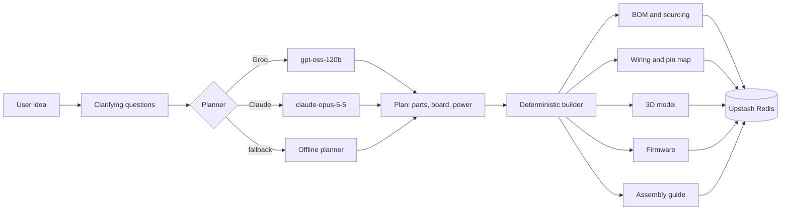

<div align="center">

# MechHub Blueprint

**Describe a machine. Get a blueprint you can build.**

MechHub Blueprint turns a plain-language idea into a complete hardware design: a priced bill of materials with buy links, a pin-accurate wiring diagram, an exportable 3D CAD model, ready-to-flash firmware and a step-by-step assembly guide.

[](https://nodejs.org)
[](tsconfig.json)
[](https://react.dev)
[](https://threejs.org)
[](#deployment)

[Quick start](#quick-start) · [How it works](#how-it-works) · [Deployment](#deployment) · [API](#api-reference) · [Testing](TESTING.md) · [Roadmap](#roadmap)

</div>

---

## The problem

Most hardware ideas stall before the first part is ordered. Turning "a weather station for my balcony" into something real means choosing a microcontroller, working out sensors, drivers and power, assigning pins, drawing the wiring, designing an enclosure, writing firmware and planning the build. That takes skills most people don't have, and even engineers need hours for it.

## What MechHub Blueprint does

You type an idea. Blueprint asks a few clarifying questions (goal, budget, board, power), then returns a buildable design in seconds. You refine it in chat: *"add a buzzer"*, *"make it cheaper"*, *"switch to Arduino Nano"*.

| Output | What you get |
| --- | --- |
| **Bill of materials** | Every part with quantity, estimated price and buy links (Amazon, AliExpress, DigiKey, maker stores). It's grouped into Electrical and Mechanical, 3D-printed parts are costed from their volume, and it exports to CSV. |
| **Wiring & schematic** | An auto-laid-out schematic for ESP32, Arduino Uno/Nano or Raspberry Pi Pico W, with a full connection list, a pin map, net tracing and SVG export. |
| **3D CAD** | An assembly model in the browser with an exploded view and part picking. Exports to **STL** (whole model, printed parts, or one part), **STEP** (AP214), **GLB** and PNG. |
| **Firmware** | An Arduino sketch written for the exact pin assignment, with the required libraries listed. Download it as `.ino`. |
| **Assembly guide** | Ordered build steps with parts, tools, safety warnings and a progress checklist. |
| **Design chat** | Conversational edits. Each change rebuilds the whole blueprint and bumps its version. |

## How it works



**The core principle: the AI decides *what* goes in the design, and the engine guarantees *how* it fits together.**

The language model only produces a `Plan`: which parts, which board, how it's powered. It can only pick parts from a curated catalog of 40 components (36 modules and 4 controller boards), and that choice is enforced by structured output validation. Everything that has to be physically correct is then derived by deterministic code in [`server/builder.ts`](server/builder.ts):

- **Drivers:** a PCA9685 when there are more than two servos, TB6612 drivers for DC motors, A4988 drivers for steppers, and relays for switched loads.
- **Power:** USB, a 2S Li-ion battery, a 12/24 V supply or solar, with buck regulation added where needed. It warns when a supply can't handle the load.
- **Pin allocation:** the hardware UART first, then analog, PWM and digital pins. The I²C bus and the stepper enable line are shared, and analog pins are reused as digital on boards that allow it.
- **Safety checks:** warnings for 3.3 V level-shifting, servo stall current and stepper current limits.

So an AI-planned design can never come out with impossible wiring. If a model call fails or the rate limit is hit, the offline planner takes over and the user still gets a blueprint.

## Tech stack

| Layer | Technology |
| --- | --- |
| Frontend | React 18, Vite 5, TypeScript, three.js (CAD viewer and rendered thumbnails) |
| API | Node.js 20+, Express 4, zod |
| AI planners | Groq (`openai/gpt-oss-120b`, JSON mode with validation), Anthropic Claude (`claude-opus-5-5`, structured outputs), offline fallback |
| Storage | Upstash Redis in production, a JSON file in local development |
| Hosting | Vercel (Build Output API: CDN for static files plus one Node 22 function) |
| Design system | MechHub theme: Geist, Geist Mono, Instrument Serif and `#0F46E1` |

## Quick start

**Prerequisites:** Node.js 20 or later, and npm.

```bash
git clone https://github.com/DivyanshuRanjanDynamic/Mechhub-blueprint.io.git
```

```bash
cd Mechhub-blueprint.io && npm install
```

```bash
cp .env.example .env
```

```bash
npm run dev
```

Open **http://localhost:5173**. The API runs on `:8787`, and Vite proxies `/api` to it.

With no API keys, the app runs entirely on the offline planner and local file storage, so you can try everything without any accounts.

## Configuration

All settings are environment variables. Set them in `.env` locally, and in the project settings on Vercel. `.env` is gitignored and must never be committed.

| Variable | Required | Description |
| --- | --- | --- |
| `GROQ_API_KEY` | Recommended | Enables the Groq planner. Get a key at [console.groq.com/keys](https://console.groq.com/keys). |
| `GROQ_MODEL` | No | Defaults to `openai/gpt-oss-120b`. |
| `ANTHROPIC_API_KEY` | No | Enables the Claude planner. |
| `ANTHROPIC_MODEL` | No | Defaults to `claude-opus-5-5`. |
| `MECHHUB_PROVIDER` | No | Forces `groq`, `claude` or `offline`. If unset, Groq is used when its key exists, then Claude, then offline. |
| `UPSTASH_REDIS_REST_URL` | In production | Upstash REST endpoint. Vercel's integration may provide `KV_REST_API_URL` instead; either works. |
| `UPSTASH_REDIS_REST_TOKEN` | In production | Upstash REST token, or `KV_REST_API_TOKEN`. |
| `MECHHUB_DATA_DIR` | No | Folder for the local JSON store. Defaults to `./data`. |
| `PORT` | No | Local API port. Defaults to `8787`. |

`GET /api/health` reports which planner, model and storage backend are active.

## Deployment

Blueprint deploys to Vercel with the [Build Output API](https://vercel.com/docs/build-output-api). `vercel.json` runs `npm run build:vercel`, which bundles the Vite site to the CDN and the whole Express API into a single Node 22 function (60-second limit). `/api/*` routes go to the function, and every other path serves the single-page app.

1. **Import the repository** in Vercel: **Add New → Project**. Keep the default build settings, because `vercel.json` sets them.
2. **Attach storage.** Go to **Storage → Create Database → Upstash for Redis**, then **Connect** it to the project. You can instead set `UPSTASH_REDIS_REST_URL` and `UPSTASH_REDIS_REST_TOKEN` yourself.
3. **Add environment variables:** `GROQ_API_KEY`, and `MECHHUB_PROVIDER=groq`.
4. **Deploy**, then open `https://<your-app>.vercel.app/api/health` and check for `"provider":"groq"` and `"storage":"redis"`.

Example projects are created on the first request. If `storage` reports `file`, Redis isn't connected: projects would go to the function's temporary `/tmp` folder and be lost, and the logs show a warning.

You can also deploy from the CLI with `npx vercel`, then `npx vercel --prod`.

To check the production output on your own machine before deploying:

```bash
npm run test:vercel
```

## Testing

| Command | Covers | Needs |
| --- | --- | --- |
| `npm test` | The design engine across 9 project types on all 4 boards: no unassigned or duplicate pins, no dangling wires, firmware present | nothing |
| `npm run e2e:mock-groq` | A full user journey (idea, questions, design, two chat edits, downloads) through the Groq backend against a local mock that deliberately sends malformed output | nothing |
| `npm run e2e -- --provider groq` | The same journey against the live Groq API | `GROQ_API_KEY` |
| `npm run test:storage` | The full API on the Redis store, using an in-memory stand-in for Upstash | nothing |
| `npm run test:vercel` | Builds the Vercel output and serves it locally with Vercel-style routing | nothing |
| `npx tsx scripts/check-redis.ts` | Read, write and delete against your configured Upstash database | Upstash credentials |
| `npx tsx scripts/groq-budget.ts` | Tokens per action and your account's Groq rate limits | `GROQ_API_KEY` |

End-to-end tests always use temporary local storage, so they never write to a real database. See [TESTING.md](TESTING.md) for the scripted user journey and manual QA prompts.

## Project structure

```
├── shared/types.ts            Plan, Blueprint, BOM, wiring and CAD types shared by client and server
├── server/
│   ├── app.ts                 Express API (used locally and on Vercel)
│   ├── index.ts               Local entry: serves dist/ and listens on :8787
│   ├── vercel.ts              Vercel function entry
│   ├── builder.ts             Deterministic Plan → Blueprint engine
│   ├── catalog.ts             Component library: pinouts, rails, prices, firmware snippets, footprints
│   ├── planner.ts             Offline planner, clarifying questions, chat edits
│   ├── ai.ts / groq.ts        LLM prompts, schemas, Claude and Groq backends
│   ├── llm.ts                 Provider selection
│   └── store.ts               Upstash Redis or JSON file store
├── src/
│   ├── pages/                 Home (landing) and Workspace (chat and the output tabs)
│   ├── components/            Parts, Schematic, CadViewer, Guide, Code, Overview, Chat
│   ├── components/home/       Hero drone, demo panel, rendered thumbnails
│   └── lib/                   STEP writer, three.js scene helpers, procedural drone
├── scripts/                   Vercel build, e2e and storage tests, Groq mock, diagnostics
├── vercel.json
└── TESTING.md
```

## API reference

All endpoints are under `/api` and return JSON.

| Method | Endpoint | Body | Description |
| --- | --- | --- | --- |
| `GET` | `/health` | – | Active planner, model and storage |
| `GET` | `/projects` | – | Project summaries, newest first |
| `POST` | `/projects` | `{ prompt, generateNow? }` | Creates a project. It returns clarifying questions, or a finished blueprint if `generateNow` is set. |
| `GET` | `/projects/:id` | – | Full project, including its blueprint and chat |
| `POST` | `/projects/:id/messages` | `{ text?, answers? }` | Answers the clarifying questions, or refines a finished design |
| `POST` | `/projects/:id/star` | `{ unstar? }` | Stars or unstars a project |
| `DELETE` | `/projects/:id` | – | Deletes a project |
| `GET` | `/showcase` | – | Top finished projects with their 3D data, for the gallery |
| `GET` | `/stats` | – | Totals for blueprints, parts, connections and printed parts |

## Capacity and cost

Measured with the app's real prompts on Groq's free tier for `openai/gpt-oss-120b` (30 requests/min, 1,000 requests/day, 8,000 tokens/min, 200,000 tokens/day):

| Action | Tokens |
| --- | --- |
| Clarifying questions | ~2,600 |
| First design | ~3,500 |
| Each chat edit | ~3,500 |
| **Typical session** (questions, design and two edits) | **~13,000** |

That allows **about 15 full sessions a day, and about 2 designs a minute**, on the free tier. Past those limits, users fall back to the offline planner without seeing an error. For production traffic, use Groq's paid tier. Run `scripts/groq-budget.ts` to re-measure after changing prompts.

## Security

- Secrets live only in environment variables. `.env` is gitignored, and `.env.example` holds placeholders only.
- API keys are used only on the server and are never sent to the browser.
- The model's output is validated against a schema and limited to catalog part IDs before anything is built from it.
- Prompts are capped at 600 characters and chat messages at 1,000, and request bodies are limited to 1 MB.
- If you ever expose a key or token, rotate it with the provider (Groq console, Upstash console).

## Limitations

- **Prices are estimates** from the catalog. Buy links open live searches, so confirm the price when you order.
- **Check the wiring against your exact modules** before you apply power. Pinouts follow common breakout boards.
- **The STEP export uses flat faces.** It imports as solids, but curved surfaces come through as 32-sided prisms.
- **No user accounts yet.** Every project is public: it appears in the homepage gallery, and anyone with the link can view or edit it.

## Roadmap

- [ ] User accounts and private projects
- [ ] Image and sketch input as a starting point
- [ ] A public community feed with forking ("Copy this build")
- [ ] Live pricing and stock from distributor APIs
- [ ] KiCad schematic export and PCB layout suggestions
- [ ] STEP export with true curved surfaces
- [ ] Shorter prompts, to raise sessions per day on any LLM plan
- [ ] A larger component catalog (motor encoders, CAN, cameras, LiDAR)

## Contributing

1. Create a branch from `main`.
2. Make your change. Keep the planner and builder split: models choose parts, `builder.ts` guarantees correctness.
3. Run `npm run typecheck`, `npm test`, `npm run e2e:mock-groq` and `npm run test:vercel`.
4. Open a pull request with a short description and screenshots for any UI change.

New components go in [`server/catalog.ts`](server/catalog.ts), with pin roles, the supply rail, current draw, a footprint size and an optional firmware snippet. The self-test checks them automatically on every board.

## License

No license has been chosen yet. Until one is added, all rights are reserved by the project owner.

---

<div align="center">

Built by **[MechHub](https://www.mechhub.in/)**. Manufacturing Tomorrow Together.

</div>
